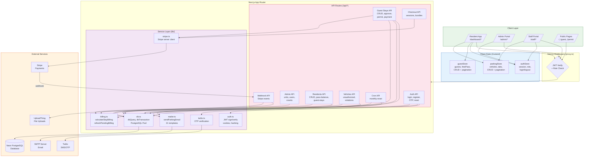
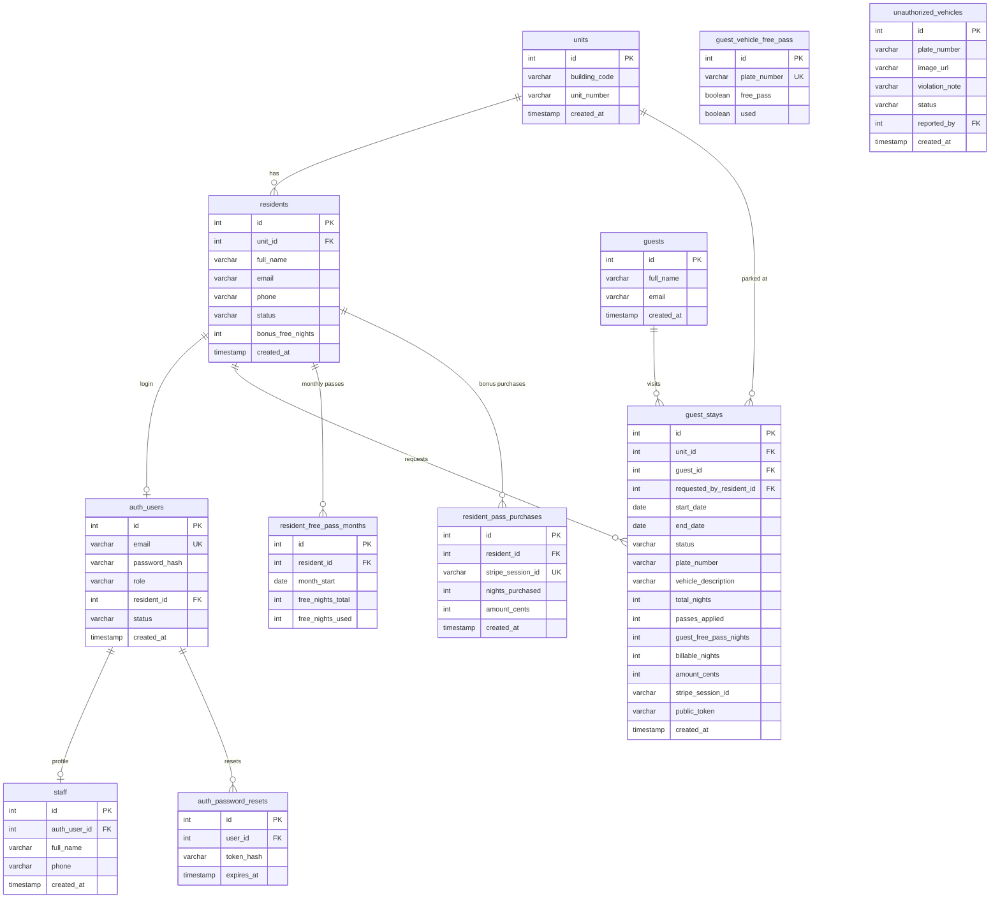
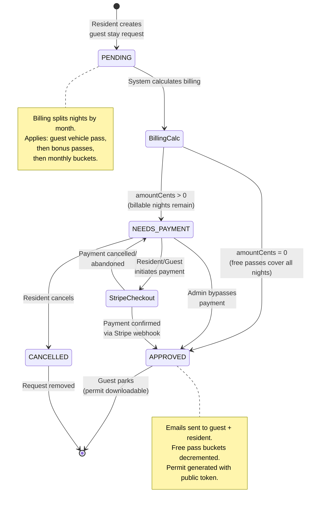
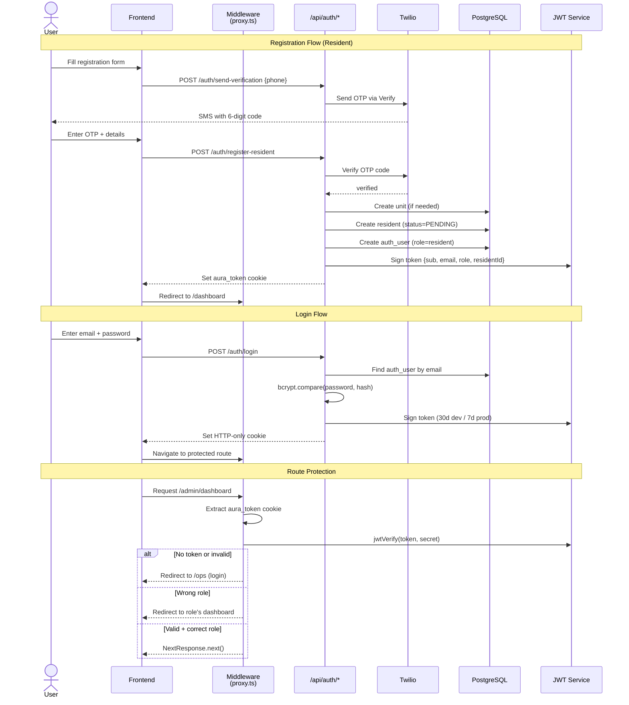
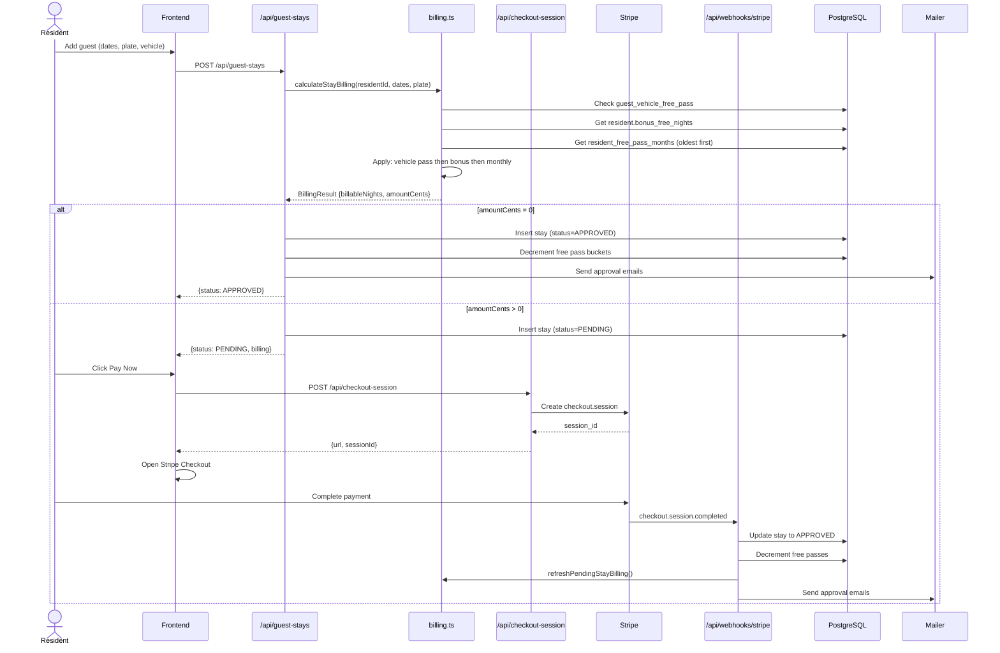
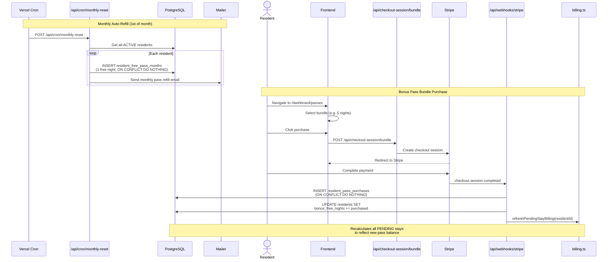
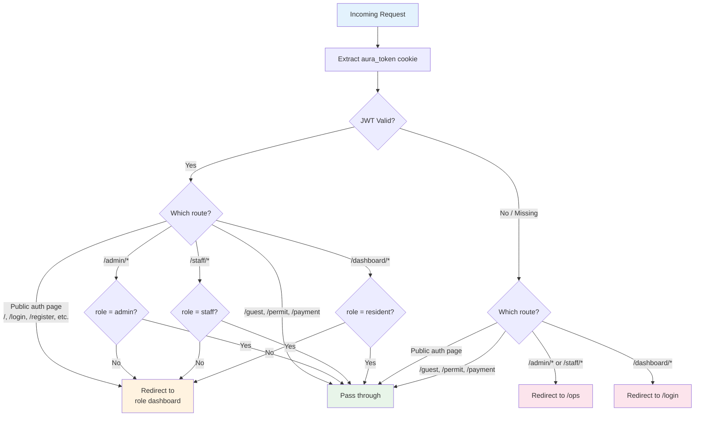
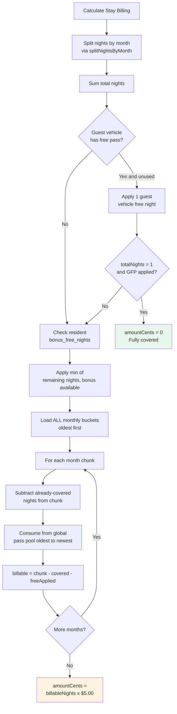
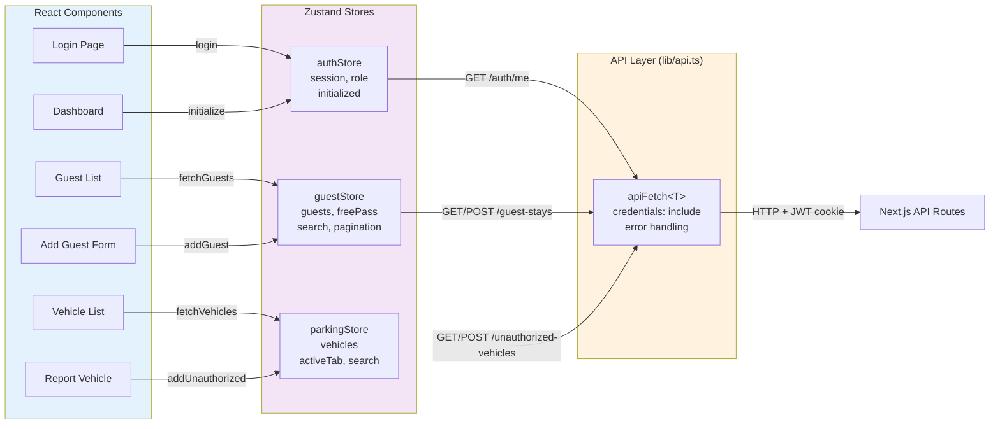
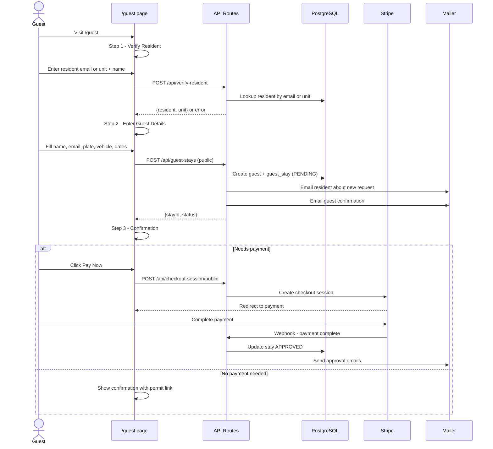

# Aura Apache Parking - Full System Analysis & Flow

## Tech Stack Overview

| Layer | Technology |
|-------|-----------|
| **Framework** | Next.js 16 (App Router) |
| **Language** | TypeScript 5, React 19 |
| **Styling** | Tailwind CSS 4 |
| **State** | Zustand 5 |
| **Database** | PostgreSQL (Neon) via `pg` |
| **Auth** | JWT (jose + jsonwebtoken), bcryptjs |
| **Payments** | Stripe (checkout + webhooks) |
| **Email** | Nodemailer (21 HTML templates) |
| **SMS/OTP** | Twilio Verify |
| **Uploads** | UploadThing |
| **Hosting** | Vercel |

---

## 1. High-Level System Architecture

---

## 2. Database Entity Relationship Diagram

---

## 3. Guest Parking Request - Complete Lifecycle

---

## 4. Authentication & Authorization Flow

---

## 5. Payment & Billing Flow

---

## 6. Monthly Pass & Bundle Purchase Flow

---

## 7. Middleware Routing Decision Tree

---

## 8. Billing Calculation - Pass Consumption Order

---

## 9. Zustand State Management Flow

---

## 10. Public Guest Request Flow

---

## 11. API Endpoints Summary

### Authentication (11 endpoints)
| Method | Endpoint | Description |
|--------|----------|-------------|
| POST | `/api/auth/login` | Login, set JWT cookie |
| POST | `/api/auth/register-resident` | Register resident (email + Twilio OTP) |
| POST | `/api/auth/register-admin` | Register admin user |
| POST | `/api/auth/register-staff` | Register staff user |
| POST | `/api/auth/logout` | Logout, clear cookie |
| GET | `/api/auth/me` | Get current user session |
| POST | `/api/auth/change-password` | Change password |
| POST | `/api/auth/forgot-password` | Request password reset email |
| POST | `/api/auth/forgot-password-phone` | Request reset via SMS |
| POST | `/api/auth/reset-password` | Reset password with token |
| POST | `/api/auth/send-verification` | Send OTP via Twilio |

### Admin (10 endpoints)
| Method | Endpoint | Description |
|--------|----------|-------------|
| GET | `/api/admin/counts` | Dashboard statistics |
| GET | `/api/admin/units` | List all units |
| POST | `/api/admin/units` | Create unit |
| GET | `/api/admin/units/[id]` | Get unit details |
| PATCH | `/api/admin/units/[id]` | Update unit |
| GET | `/api/admin/users` | List admin/staff users |
| POST | `/api/admin/users` | Create user |
| GET | `/api/admin/users/[id]` | Get user details |
| PATCH | `/api/admin/users/[id]` | Update user |
| POST | `/api/admin/users/[id]/activate` | Activate pending user |

### Residents (8 endpoints)
| Method | Endpoint | Description |
|--------|----------|-------------|
| GET | `/api/residents` | List all residents |
| POST | `/api/residents` | Create resident |
| GET | `/api/residents/[id]` | Get resident details |
| PATCH | `/api/residents/[id]` | Update resident |
| DELETE | `/api/residents/[id]` | Delete resident |
| GET | `/api/residents/[id]/guest-stays` | Get resident's guest stays |
| GET | `/api/residents/[id]/pass-balance` | Get pass balance |
| GET | `/api/residents/[id]/free-pass-months` | Get monthly pass buckets |

### Guest Stays (9 endpoints)
| Method | Endpoint | Description |
|--------|----------|-------------|
| GET | `/api/guest-stays` | List guest stays with filters |
| POST | `/api/guest-stays` | Create guest stay |
| GET | `/api/guest-stays/[id]` | Get stay details |
| PATCH | `/api/guest-stays/[id]` | Update stay |
| DELETE | `/api/guest-stays/[id]` | Delete/cancel stay |
| POST | `/api/guest-stays/[id]/approve` | Approve stay |
| POST | `/api/guest-stays/[id]/admin-bypass-payment` | Admin bypass payment |
| GET | `/api/guest-stays/[id]/permit` | Get permit data |
| GET | `/api/guest-stays/[id]/payment-info` | Get payment details |

### Checkout & Payments (5 endpoints)
| Method | Endpoint | Description |
|--------|----------|-------------|
| POST | `/api/checkout-session` | Create Stripe checkout |
| GET | `/api/checkout-session/[id]` | Get session status |
| POST | `/api/checkout-session/bundle` | Create pass bundle checkout |
| POST | `/api/checkout-session/public` | Create public guest checkout |
| POST | `/api/webhooks/stripe` | Stripe webhook handler |

### Vehicles & Other (8 endpoints)
| Method | Endpoint | Description |
|--------|----------|-------------|
| GET | `/api/unauthorized-vehicles` | List violations |
| POST | `/api/unauthorized-vehicles` | Report vehicle |
| GET | `/api/unauthorized-vehicles/[id]` | Get violation details |
| DELETE | `/api/unauthorized-vehicles/[id]` | Delete violation |
| PATCH | `/api/unauthorized-vehicles/[id]/resolve` | Resolve violation |
| GET | `/api/guest-vehicle-free-pass/[plate]` | Check plate free pass |
| POST | `/api/verify-resident` | Verify resident for guest form |
| POST | `/api/cron/monthly-reset` | Monthly pass allocation |

---

## 12. Security Summary

| Feature | Implementation |
|---------|---------------|
| **Authentication** | JWT in HTTP-only cookies (jose + jsonwebtoken) |
| **Password Storage** | bcryptjs with salt rounds |
| **Phone Verification** | Twilio Verify OTP |
| **Route Protection** | Middleware role-based gating (proxy.ts) |
| **Rate Limiting** | In-memory sliding window (5 login/15min, 3 SMS/10min) |
| **SQL Injection** | Named parameterized queries via dbQuery |
| **Password Reset** | SHA-256 hashed tokens with expiry |
| **CSP Headers** | Content Security Policy in next.config.ts |
| **Idempotency** | ON CONFLICT DO NOTHING for Stripe webhooks |
| **Token Expiry** | 7 days (prod) / 30 days (dev) |
